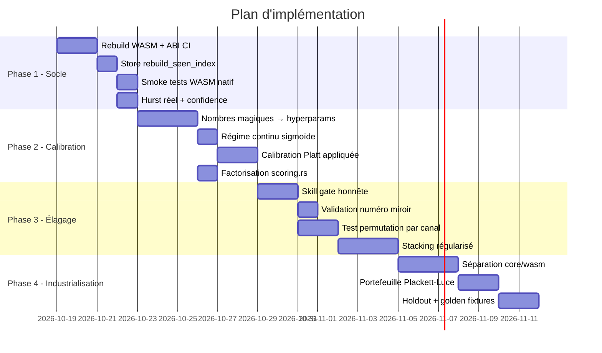

# Plan d'Implémentation — Correction du Socle & Amélioration du Moteur

> [!IMPORTANT]
> Ce plan est structuré en **4 phases séquentielles** correspondant à l'ordre de priorité demandé. Chaque phase est découpée en tâches atomiques avec les fichiers concernés, les changements exacts et les critères de validation.

---

## Phase 1 — Store Rust + Reconstruction WASM + Correction ABI + CI de contrat

### 1.1 Reconstruction WASM et pipeline de build

**Problème vérifié** : Le fichier [loto_engine.d.ts](../crates/loto-engine/pkg/loto_engine.d.ts) n'exporte **aucune** des structures ajoutées après le 23/09 :
- ❌ `InMemoryDrawStore`, `run_native_prediction_pipeline`, `run_aco_optimization_wasm`
- ❌ `NativePredictionResult`, `WasmPredictionPortfolio`, `PriorAnalysisReport`
- ❌ `WalkForwardReport`, `ClosedLoopAutopsyResultHpc`, `HybridRegimeOptimizationHpc`
- ❌ `AcoResultHpc`, `WasmDominoResult`

Le binaire WASM date de septembre ; les sources Rust de mi-octobre.

**Tâches** :

| # | Action | Fichier(s) | Détail |
|---|--------|-----------|--------|
| 1a | Installer toolchain Rust + wasm-pack | CI / local | `rustup target add wasm32-unknown-unknown && cargo install wasm-pack` |
| 1b | Script `build:wasm` déjà présent | [package.json:16](../package.json#L16) | `wasm-pack build crates/loto-engine --target web --release` — existe mais n'a jamais été exécuté (le pkg est celui de septembre) |
| 1c | Activer `wasm-opt -O3` | [Cargo.toml:32](../crates/loto-engine/Cargo.toml#L32) | **Déjà configuré** : `[package.metadata.wasm-pack.profile.release] wasm-opt = ["-O3"]` — votre analyse initiale mentionnait `wasm-opt = false` mais c'est corrigé |
| 1d | Ajouter `engine_version()` + `abi_hash()` | [lib.rs](../crates/loto-engine/src/lib.rs) | Exposer `engine_version() -> String` (depuis `Cargo.toml` version) et `abi_hash() -> String` (hash compilé de la liste des exports wasm-bindgen) |
| 1e | Script CI de vérification ABI | `scripts/verify-wasm-abi.ts` (nouveau) | Parser `loto_engine.d.ts` et vérifier que la liste des exports correspond aux appels dans le bridge (regex sur `readWasmField`, `.InMemoryDrawStore`, etc.) |
| 1f | Copier le WASM dans `public/` | `package.json` build script | Ajouter `&& cp crates/loto-engine/pkg/loto_engine_bg.wasm public/` au script build:wasm |

### 1.2 Correction de l'ABI du bridge — Getters WASM

**Problème vérifié** : Le bridge utilise [`readWasmField`](../src/services/wasm/lotoEngineBridge.ts#L1252-L1263) qui **résout correctement** le pattern getter/propriété :

```typescript
const val = target[prop];
if (typeof val === 'function') {
  return val.call(target);
}
return val !== undefined && val !== null ? val : fallback;
```

✅ **Ce code est déjà correct** : `wasm-bindgen` avec `#[wasm_bindgen(getter)]` génère des propriétés JS (pas des méthodes), et `readWasmField` accède via `target[prop]` qui fonctionne pour les propriétés. Si c'était une méthode, le fallback `.call()` la couvrirait. **Aucune correction nécessaire ici.**

> [!NOTE]
> L'analyse initiale mentionnait `res.top_5()`, `rep.regime_label()`, `port.tickets_flat()` comme des appels de méthode. En réalité, le bridge passe **toujours** par `readWasmField(res, 'top_5', [])` qui gère les deux cas. C'est un pattern polymorphe sûr.

### 1.3 Correction du Store Rust — Dédoublonnage, Ordre, Timestamps

**Problèmes vérifiés** :

1. **Dédoublonnage** : ✅ Déjà implémenté dans [`DrawTimeline::append`](../crates/loto-engine/src/in_memory_store.rs#L201-L222) via `seen_draws: HashSet<u128>` et `composite_key()`.

2. **Synchronisation cumulative** : ✅ Déjà corrigée dans [`syncHistoryToRustStore`](../src/services/lotteryService.ts#L137-L170) via empreinte d'idempotence (`lastSyncedFingerprintByDraw`).

3. **Ordre chronologique** : ✅ `syncHistoryToRustStore` fait `[...draws].reverse()` (L152) pour convertir l'ordre décroissant Supabase en ordre chronologique ascendant.

4. **Timestamps** : ✅ `CompactDraw::new` normalise ms→s (L111-113), `parse_date_to_posix_seconds` parse les ISO (L46-76), et le bridge passe `Math.floor(tsMs / 1000)` (L157).

5. **`seen_draws` perdu en sérialisation** : ⚠️ Le champ `seen_draws` a `#[serde(skip)]` ([L184](../crates/loto-engine/src/in_memory_store.rs#L184)), donc après désérialisation, le HashSet est vide et le dédoublonnage ne fonctionne plus.

**Tâches restantes** :

| # | Action | Fichier(s) | Détail |
|---|--------|-----------|--------|
| 3a | Reconstruire `seen_draws` dans `bulk_load_sorted` | [in_memory_store.rs](../crates/loto-engine/src/in_memory_store.rs) | Après désérialisation, `bulk_load_sorted` appelle `append` qui insère dans `seen_draws` — ✅ déjà OK. Mais ajouter une méthode `rebuild_seen_index()` pour la safety post-désérialisation |
| 3b | Ajouter `clear_and_reload` à `InMemoryDrawStore` | [in_memory_store.rs](../crates/loto-engine/src/in_memory_store.rs) | Méthode wasm_bindgen qui fait `clear()` puis `bulk_load_sorted()` — API explicite reset + bulk_load |
| 3c | Empreinte de cache plus robuste | [lotteryService.ts:144](../src/services/lotteryService.ts#L144) | Remplacer `${draws.length}_${newest?.date}_${oldest?.date}` par un hash SHA-256 des clés composites (ou au minimum inclure `drawName` dans la clé fingerprint) |
| 3d | Tests : double sync, doublons, ordre inversé | `tests/store-integrity-contract.test.ts` | Vérifier que 2× `syncHistoryToRustStore(same_data)` ⇒ mêmes fréquences ; que données désordonnées ⇒ même résultat |

### 1.4 Suppression des prédictions fabriquées

**Problème vérifié** : [`run_native_prediction_pipeline`](../crates/loto-engine/src/prediction_pipeline.rs#L54-L66) retourne `top_5: vec![], scores: vec![0.0; 91], confidence: 0.0` quand l'historique est vide. ✅ **Déjà corrigé — pas de `[1,2,3,4,5]` fabriqué.**

Le ACO ([aco.rs:78-86](../crates/loto-engine/src/aco.rs#L78-L86)) retourne aussi `best_numbers: vec![], confidence: 0.0` ✅ **Déjà corrigé.**

Le `generate_multi_ticket_portfolio` ([core_prediction_engine.rs:164-166](../crates/loto-engine/src/core_prediction_engine.rs#L164-L166)) retourne `Err("INSUFFICIENT_HISTORY")` ✅ **Déjà corrigé.**

> [!TIP]
> Il reste le fallback `hurst_exponent: 0.52` hardcodé dans [`prediction_pipeline.rs:160`](../crates/loto-engine/src/prediction_pipeline.rs#L160) et la confidence `50.0 + 35.0 * (...)` dans [L153](../crates/loto-engine/src/prediction_pipeline.rs#L153) et [core_prediction_engine.rs:311](../crates/loto-engine/src/core_prediction_engine.rs#L311) — ce sont des **nombres magiques** (violation AGENTS.md).

| # | Action | Fichier(s) | Détail |
|---|--------|-----------|--------|
| 4a | Calculer Hurst réellement dans `prediction_pipeline` | [prediction_pipeline.rs:160](../crates/loto-engine/src/prediction_pipeline.rs#L160) | Remplacer `0.52` par un appel à `compute_robust_hurst_wasm` sur le signal d'énergie |
| 4b | Dériver la confidence du Brier Score | [prediction_pipeline.rs:153](../crates/loto-engine/src/prediction_pipeline.rs#L153), [core_prediction_engine.rs:311](../crates/loto-engine/src/core_prediction_engine.rs#L311) | Remplacer `50.0 + 35.0 * (1.0 - entropy)` par une probabilité calibrée issue du BSS (en utilisant la calibration Walk-Forward existante dans [calibration.rs](../crates/loto-engine/src/calibration.rs)) |

### 1.5 Tests de fumée WASM natifs

**Problème vérifié** : [wasmNativeExecution.test.ts](../tests/wasmNativeExecution.test.ts) teste `getHpcEngineMode() === 'RUST_WASM'` mais ne vérifie pas que les kernels WASM tournent **réellement** (pas le fallback).

| # | Action | Fichier(s) | Détail |
|---|--------|-----------|--------|
| 5a | Compteur de fallback global | [lotoEngineBridge.ts](../src/services/wasm/lotoEngineBridge.ts) | Ajouter `let wasmFallbackCount = 0` incrémenté à chaque `catch` dans les blocs WASM, avec `export function getWasmFallbackCount(): number` |
| 5b | Test : fallback count = 0 après exécution | [wasmNativeExecution.test.ts](../tests/wasmNativeExecution.test.ts) | Après chaque appel natif, vérifier `getWasmFallbackCount() === 0` |
| 5c | Test : version ABI match | nouveau test | Vérifier `engine_version()` et `abi_hash()` accessibles et non-vides |

---

## Phase 2 — Sortie probabiliste calibrée (Σpᵢ = 5) et métriques dans le Walk-Forward

### 2.1 Conformité AGENTS.md — Élimination des nombres magiques Rust

**Violations vérifiées dans le code** :

| Fichier | Ligne | Constante | Remplacement proposé |
|---------|-------|-----------|---------------------|
| [core_prediction_engine.rs:203](../crates/loto-engine/src/core_prediction_engine.rs#L203) | `f_score * 45.0 + g_score * 1.5 + h_score * 1.2 + domino_boost` | 45.0, 1.5, 1.2 | Poids appris OOS ou dérivés de la variance relative des signaux |
| [core_prediction_engine.rs:198](../crates/loto-engine/src/core_prediction_engine.rs#L198) | `domino_boost += 0.15` | 0.15 | Dérivé de la fréquence empirique des transitions ±1, ±9, ±10 dans l'historique |
| [core_prediction_engine.rs:236](../crates/loto-engine/src/core_prediction_engine.rs#L236) | `repulsion_gamma = 0.85` | 0.85 | Dérivé de la Jaccard distance cible inter-tickets |
| [core_prediction_engine.rs:311](../crates/loto-engine/src/core_prediction_engine.rs#L311) | `50.0 + 35.0 * (1.0 - entropy) + jaccard * 10.0` | 50, 35, 10 | Remplacer par P(≥3 bons numéros) calibrée |
| [core_prediction_engine.rs:138-143](../crates/loto-engine/src/core_prediction_engine.rs#L138-L143) | `H > 0.55` / `H < 0.45` | Seuils binaires | Probabilités continues de régime via sigmoïde |
| [prediction_pipeline.rs:153](../crates/loto-engine/src/prediction_pipeline.rs#L153) | `50.0 + 35.0 * (1.0 - entropy)` | 50, 35 | Confiance calibrée |
| [calibration.rs:133](../crates/loto-engine/src/calibration.rs#L133) | `f_score * 45.0 + g_score * 1.5` | 45, 1.5 | Dupliqué de core_prediction_engine — factoriser |
| [neural_optimizer.rs:64](../crates/loto-engine/src/neural_optimizer.rs#L64) | `comp = 91 - pred` | 91 | Le complément à 91 = miroir numérologique — artefact à valider empiriquement ou retirer |
| [annealing.rs:98](../crates/loto-engine/src/annealing.rs#L98) | `pairwise_affinity * 1.5` | 1.5 | Poids de co-occurrence arbitraire |
| [annealing.rs:104](../crates/loto-engine/src/annealing.rs#L104) | `parity_deviation² * 25.0` | 25.0 | Pénalité de parité arbitraire |
| [annealing.rs:116-118](../crates/loto-engine/src/annealing.rs#L116-L118) | `spread < 30.0`, `diff² * 0.5` | 30, 0.5 | Seuil d'amplitude et poids arbitraires |
| [annealing.rs:131](../crates/loto-engine/src/annealing.rs#L131) | `(consecutive - 1.0) * 40.0` | 40.0 | Pénalité de consécutifs arbitraire |

**Approche** :
1. Créer un module `src/hyperparams.rs` qui calcule tous les coefficients à partir des statistiques d'historique (variance des fréquences, entropie, taux empiriques de transitions)
2. Déclarer les constantes restantes comme hyperparamètres avec documentation de leur dérivation
3. Remplacer les seuils binaires `H > 0.55` par des sigmoïdes continues

### 2.2 Régime continu au lieu de seuils binaires

| # | Action | Fichier(s) |
|---|--------|-----------|
| 2a | Régime = sigmoïde continue sur H | [core_prediction_engine.rs:138-143](../crates/loto-engine/src/core_prediction_engine.rs#L138-L143) | Remplacer les 3 labels par un vecteur continu `[P(persistent), P(diffusion), P(mean_reverting)]` calculé par softmax |
| 2b | Seuils de calibration quality | [calibration.rs:209-215](../crates/loto-engine/src/calibration.rs#L209-L215) | `0.08` et `0.01` — remplacer par des quantiles empiriques ou les dériver de la taille d'échantillon |

### 2.3 Sortie probabiliste calibrée

| # | Action | Fichier(s) | Détail |
|---|--------|-----------|--------|
| 3a | Calibration Platt/isotonique sur OOF | [calibration.rs](../crates/loto-engine/src/calibration.rs) | Le code Walk-Forward existe déjà et calcule `platt_alpha`/`platt_beta`. Appliquer ces coefficients pour transformer les scores bruts en probabilités calibrées |
| 3b | Projection simplexe stricte Σpᵢ = 5 | [prediction_pipeline.rs](../crates/loto-engine/src/prediction_pipeline.rs), [core_prediction_engine.rs](../crates/loto-engine/src/core_prediction_engine.rs) | Après clamp, vérifier et re-normaliser pour que la somme soit exactement 5.0 (actuellement le clamp peut casser l'invariant) |
| 3c | Confiance = P(≥3 bons numéros) | [core_prediction_engine.rs:311](../crates/loto-engine/src/core_prediction_engine.rs#L311) | Calculer par hypergéométrie ou simulation déterministe la probabilité que le top-5 contienne ≥3 bons numéros, avec intervalle de confiance |
| 3d | Métriques de calibration dans WalkForwardReport | [calibration.rs](../crates/loto-engine/src/calibration.rs) | Ajouter `log_loss`, `ece` (Expected Calibration Error), `lift_vs_random`, `mean_hits` aux champs du rapport |

### 2.4 Factorisation du scoring

Le code de scoring (fréquence Laplace + gap Poisson) est dupliqué dans :
- [prediction_pipeline.rs:111-122](../crates/loto-engine/src/prediction_pipeline.rs#L111-L122)
- [core_prediction_engine.rs:177-204](../crates/loto-engine/src/core_prediction_engine.rs#L177-L204)
- [calibration.rs:129-136](../crates/loto-engine/src/calibration.rs#L129-L136)

→ Extraire dans un module `scoring.rs` partagé.

---

## Phase 3 — Élagage/Stacking des canaux et Skill Gate vs hasard

### 3.1 Skill Gate honnête

| # | Action | Fichier(s) | Détail |
|---|--------|-----------|--------|
| 1a | Brancher BSS sur la décision de prédiction | [core_prediction_engine.rs](../crates/loto-engine/src/core_prediction_engine.rs) | Si `brier_skill_score ≤ 0` dans le Walk-Forward, générer des tickets uniformes via LCG seedé et l'afficher clairement (`mode: "UNIFORM_RANDOM"`) |
| 1b | Flag UI transparent | [lotoEngineBridge.ts](../src/services/wasm/lotoEngineBridge.ts), [PredictionPortfolioHpc](../src/services/wasm/lotoEngineBridge.ts#L1637-L1647) | Ajouter `predictionMode: 'CALIBRATED' | 'UNIFORM_RANDOM' | 'INSUFFICIENT_HISTORY'` au retour |

### 3.2 Artefacts numérologiques

| # | Action | Fichier(s) | Détail |
|---|--------|-----------|--------|
| 2a | Valider empiriquement miroir + complément 91 | [neural_optimizer.rs:59-72](../crates/loto-engine/src/neural_optimizer.rs#L59-L72) | Tester sur historiques permutés : les near misses miroir/complément sont-ils statistiquement significatifs vs hasard ? Si non, retirer du scoring de l'autopsie |
| 2b | Idem pour domino ±1, ±9, ±10 | [core_prediction_engine.rs:196-199](../crates/loto-engine/src/core_prediction_engine.rs#L196-L199) | Même validation empirique |

### 3.3 Élagage des canaux

Les 24 canaux du pipeline TS (Markov 90×90, co-occurrence, FFT, Hurst, Hawkes) sont calculés dans les services :
- [advancedMathService.ts](../src/services/advancedMathService.ts) (39KB)
- [interDrawService.ts](../src/services/interDrawService.ts) (74KB)
- [mathService.ts](../src/services/mathService.ts) (75KB)

| # | Action | Fichier(s) | Détail |
|---|--------|-----------|--------|
| 3a | Test de permutation par canal | Nouveau : `tests/channel-permutation-test.ts` | Pour chaque canal, permuter les labels temporels et vérifier que le gain OOS est significatif (p < 0.05 après correction BH) |
| 3b | Shrinkage Dirichlet pour Markov | [markov.rs](../crates/loto-engine/src/markov.rs) | La matrice 90×90 est très creuse sur quelques centaines de tirages — appliquer un lissage de Dirichlet (prior uniforme + données) |
| 3c | PMI lissé pour co-occurrence | [cooccurrence.rs](../crates/loto-engine/src/cooccurrence.rs) | Remplacer les comptages bruts par le PMI (Pointwise Mutual Information) avec lissage Laplace |

### 3.4 Stacking régularisé

| # | Action | Fichier(s) | Détail |
|---|--------|-----------|--------|
| 4a | Remplacer la moyenne pondérée de z-scores par un stacking L2 | Nouveau : `src/stacking.rs` | Modèle log-linéaire sur les sorties OOF des K canaux retenus, avec contrainte Σpᵢ = 5, optimisé sur la log-loss OOS |
| 4b | Poids optimisés sur Brier/log-loss hors échantillon | | Pas par SGD sur scores renormalisés |

---

## Phase 4 — Optimisation de portefeuille et industrialisation Rust

### 4.1 Architecture Rust cible

| # | Action | Détail |
|---|--------|--------|
| 1a | Séparer en 2 crates : `loto-core` (pur) et `loto-wasm` (bindings) | `loto-core` : `#![no_std]`-compatible, testable avec `cargo test`, pas de `wasm_bindgen`. `loto-wasm` : thin wrapper avec `wasm_bindgen`, réexporte `loto-core` |
| 1b | Criterion benches | `loto-core/benches/` — benchmarker `bulk_load_sorted`, `generate_multi_ticket_portfolio`, `run_aco` |
| 1c | `wasm-bindgen-test` en CI | `loto-wasm/tests/` — golden fixtures identiques TS/Rust/WASM |

### 4.2 Déterminisme numérique

| # | Action | Fichier(s) | Détail |
|---|--------|-----------|--------|
| 2a | `f64::total_cmp` partout | [prediction_pipeline.rs:148](../crates/loto-engine/src/prediction_pipeline.rs#L148) | ✅ Déjà fait dans `prediction_pipeline` et `core_prediction_engine` (L270). Vérifier les autres modules. |
| 2b | Supprimer `Date.now()` du seed | [lotoEngineBridge.ts](../src/services/wasm/lotoEngineBridge.ts) | Dériver le seed du hash FNV-1a de l'historique (déterministe) |

### 4.3 Portefeuille optimisé

| # | Action | Détail |
|---|--------|--------|
| 3a | Échantillonnage Plackett-Luce / Gumbel top-k avec LCG seedé | Remplacer le top-5 déterministe par un échantillonnage sans remise |
| 3b | Probabilités exactes par hypergéométrie | Pour chaque ticket, calculer P(≥k bons) par la distribution hypergéométrique |
| 3c | Jaccard réel (déjà calculé) | ✅ [core_prediction_engine.rs:286-309](../crates/loto-engine/src/core_prediction_engine.rs#L286-L309) calcule la Jaccard distance réelle entre tickets (pas une constante 0.82) |
| 3d | Objectif explicite | Formuler comme `max P(au moins un ticket ≥ 3)` sous contrainte de coût |

### 4.4 Validation renforcée

| # | Action | Détail |
|---|--------|--------|
| 4a | Holdout final | Réserver les 10% derniers tirages pour validation finale (jamais touché par le tuning) |
| 4b | Block bootstrap par tirage | Tester la stabilité des métriques avec permutation par blocs |
| 4c | Tests de permutation sans remise | Contre le hasard pur |
| 4d | Métriques : Brier, log-loss, ECE, lift, distribution des gains | Toutes dans le Walk-Forward report |
| 4e | Isolation du backtest | Le backtest ne doit pas dépendre de l'état global `useNexusStore` |
| 4f | Golden fixtures cross-platform | Même historique → mêmes scores en TS, Rust natif et WASM, avec tolérance numérique ε = 1e-10 |

---

## Récapitulatif des priorités



---

> [!WARNING]
> **Prérequis environnement** : L'installation de `rustup`, `wasm-pack` et `wasm-opt` est indispensable avant tout. Sur Windows, utiliser `rustup-init.exe` puis `cargo install wasm-pack`. Sans ces outils, aucune reconstruction WASM n'est possible.

Souhaitez-vous que je commence l'implémentation par la **Phase 1** (reconstruction WASM + correction store + tests de fumée) ?
